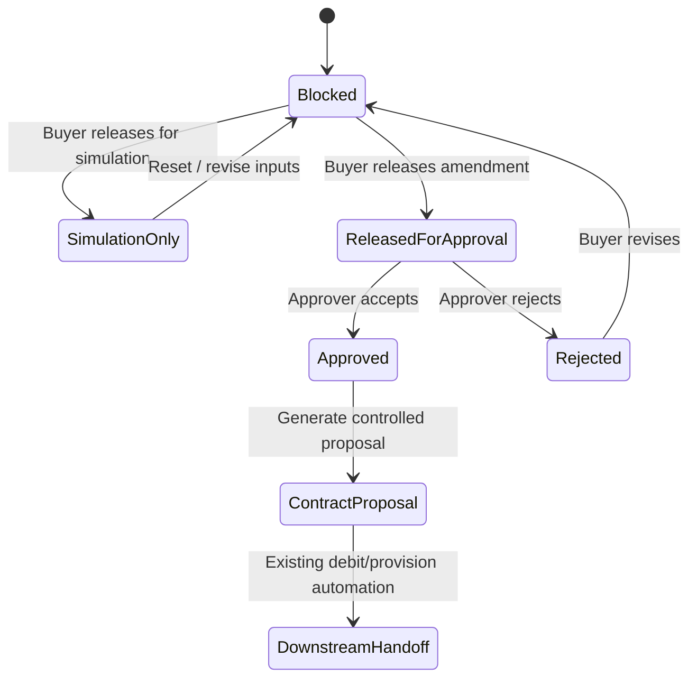

# Personas and Functional Scope

## Authority and increment boundary

This document records the confirmed business scope supplied on 27 October 2026. It refines the trial design while remaining subordinate to `PROJECT_GUIDELINES.md`.

Calculation Bucket and Calculation Run are deferred. Approved contract-price changes hand off to the existing downstream automation that creates debit postings for decreases and provisions for increases. The RMC application must preserve the approval, proposal and handoff evidence but must not duplicate that automation.

## Personas and ownership

| Persona | Maintains | Approves | Key restrictions |
|---|---|---|---|
| RM Admin | RM type, grade, subgrade validity and deletion markers | Buyer requests for new RM type/grade/subgrade | Approved codes are immutable; only validity closure or deletion marking is allowed |
| Commodity Admin | Acceptable commodity catalog and validity | Commodity activation/retirement under configured policy | Only valid, active commodities may classify RM types |
| Buyer | RM-master requests, vendor-part linkage, contract allocation, composition, revised-price requests and price-document release | None in maker-checker production mode | Cannot activate requested RM masters or approve own financial/composition changes |
| Approver | Composition and missing-contract exception requests; price-document approval under policy | Composition, no-contract exception and released price documents | Stale versions and unresolved mandatory data-quality findings cannot be approved |

Authorization must combine persona role with company code, purchasing organization, plant and supplier scope.

### Trial persona visualization

Until productive authentication is configured, the top-right **View as** selector switches between Buyer, RM Admin, Commodity Admin and Approver workspaces. It filters tabs, entry forms and action buttons to make ownership and maker-checker separation visible during review. **All personas (demo)** retains the complete end-to-end workspace. The selector does not grant authority and does not replace CAP authorization annotations or future IAS/XSUAA enforcement.

## End-to-end process

```mermaid
flowchart LR
    B[Buyer requests RM master] --> RA[RM Admin review]
    RA -->|approve| M[Valid RM type / grade / subgrade]
    RA -->|reject| BR[Buyer rework]
    CA[Commodity Admin] --> C[Acceptable commodity]
    C --> M
    M --> VPL[Vendor + Part linkage]
    VPL --> Q{Valid contract?}
    Q -->|yes| VC[Allocate contract item]
    Q -->|no| EX[Additional exception approval]
    EX --> LATER[Contract may be allocated later]
    VC --> BOM[BOM explosion]
    LATER --> BOM
    BOM --> COMP[Leaf-part RM composition + revision]
    COMP --> AP[Composition approval]
    AP --> RP[Vendor/RM revised price approval]
    RP --> IP[Identify impacted linked parts]
    IP --> PD[Blocked price document]
    PD -->|simulation only| SIM[Analysis without approval]
    PD -->|buyer releases amendment| PDA[Price-document approval]
    PDA --> CPU[Approved contract-price proposal / handoff]
```



## 1. Governed RM and commodity master

### Hierarchy and search

```text
Acceptable Commodity
  -> RM Type (RM type code + name)
      -> RM Grade (grade code + name)
          -> RM Subgrade (subgrade code + name)
```

Search/value help must display both code and name at every level. Only records that are active, not marked for deletion and valid on the business date are selectable for new transactions.

### Required fields

- Commodity: code, name, description, valid-from/to, active/deletion marker, owner, created/changed metadata
- RM type: code, name, commodity, default currency/UoM, valid-from/to, lifecycle status, deletion marker, created by/at, approved by/at, version
- Grade: type, grade code/name, specification, default yield/recovery, price index, valid-from/to, status, deletion marker, created and approved metadata
- Subgrade: grade, subgrade code/name, specification/classification, valid-from/to, status, deletion marker, created and approved metadata
- Master request: request number/type, proposed hierarchy and fields, validity, reason/evidence, requester, status, RM Admin decision/comment/time, object created

### Control rules

1. A Buyer may request creation but cannot activate a master record.
2. RM Admin approval creates the selectable master record.
3. Approved codes and descriptions are not edited in place. Corrections require a new code/version.
4. Allowed lifecycle changes are validity closure and deletion marking; physical deletion is prohibited after use.
5. Parent and child validity must overlap; a child cannot outlive an invalid/deleted parent.
6. Duplicate code/name and overlapping active versions are rejected.
7. Historical transactions continue to show expired/deleted master snapshots.

## 2. Vendor-part-contract linkage and material composition

### Linkage fields

- Supplier/business partner, material/part, plant and purchasing organization
- Contract/item when available, contract validity and allocation status
- Missing-contract reason, exception request/status/approver/comment/time
- Part revision level, linkage valid-from/to and status
- Contract allocation date/actor and source-system validation result

### Composition fields

- Profile ID/version/revision, part, supplier, contract context, valid-from/to and approval status
- BOM header/usage/alternative/change number/key date and explosion timestamp
- Parent/child material, hierarchy depth and lineage path
- Leaf-part indicator and item type
- RM type, grade and subgrade
- Input/gross weight, output/net RM weight, scrap weight, UoM and percentage
- Yield/recovery/scrap/conversion factors, source and override reason
- Completeness, exception and data-quality status
- Created/submitted/approved actor and timestamp

### Behavior

1. Buyer selects material and supplier first.
2. The application shows valid contract items for that combination.
3. If none exists, Buyer may continue only through an additional no-contract exception approval. Contract allocation remains open and searchable later.
4. BOM explosion displays the entire supported hierarchy. RM composition is maintained at leaves; a part with no children is itself the leaf.
5. Composition validity and part revision are mandatory because material composition changes over time.
6. Composition approval freezes an immutable version. A revision creates a new profile/version.
7. Approval is blocked for invalid RM hierarchy, missing mandatory weights/UoM, overlapping validity, incomplete leaf mapping or unapproved contract exception.

## 3. Revised prices and impacted parts

Price is maintained at Supplier + RM Type + Grade + Subgrade with organizational scope and validity.

Required fields include current/revised price, currency, per/price unit, UoM, valid-from/to, source/evidence, reason, Buyer, approval status/history and version. Price or validity changes always require approval.

After approval, impacted parts are determined from effective vendor-part linkages and approved composition versions. The impact list must show supplier, part, revision, plant, contract/item or missing-contract state, RM hierarchy, current/revised RM price, validity and readiness/exception state.

## 4. Price document

### State model



Every amendment begins blocked. Simulation-only release is analysis and requires no approval. Amendment release enters approval; it must not update a contract before approval.

### Header and report metrics

- Document/reference, Buyer, reason, validity, status/mode/release state
- Vendors affected, total materials/parts, plants, contracts and RM combinations
- Current/revised contract price, unit delta and percentage
- Eligible GRN count/quantity for the retrospective period and total estimated impact
- Missing-contract, mapping, validity, UoM/currency and data-quality exceptions

### Views

1. Detail: supplier-wise parts and composition, current/revised RM rates and line delta.
2. Estimation: GRN period/quantity, price unit delta, total impact and trace.
3. Summary: vendors, materials, plants, contracts, RMs, positive/negative impact and readiness.
4. Graphs: current versus proposed cost composition; impact by vendor/part/plant/RM; workflow and release state.
5. Approval: maker, release mode, decision, comments, version and segregation-of-duty evidence.

### Approval outcome

Approval produces an auditable contract-price proposal and downstream handoff. The system must distinguish a price decrease (existing debit-posting automation) from a price increase (existing provision automation). Calculation buckets/runs are not part of this increment.

## Acceptance priorities

1. Complete persona/role model and governed master-request journey.
2. Implement vendor-part linkage, no-contract exception and later contract allocation.
3. Add revisioned BOM hierarchy and leaf-level composition approval.
4. Add subgrade-aware revised prices and impacted-part list.
5. Complete blocked/simulation/amendment price-document release and approval.
6. Expand price-document summary and graphs while retaining exact server-side decimal calculations.
