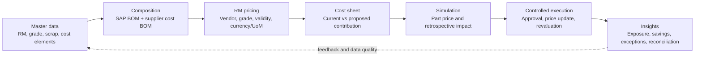
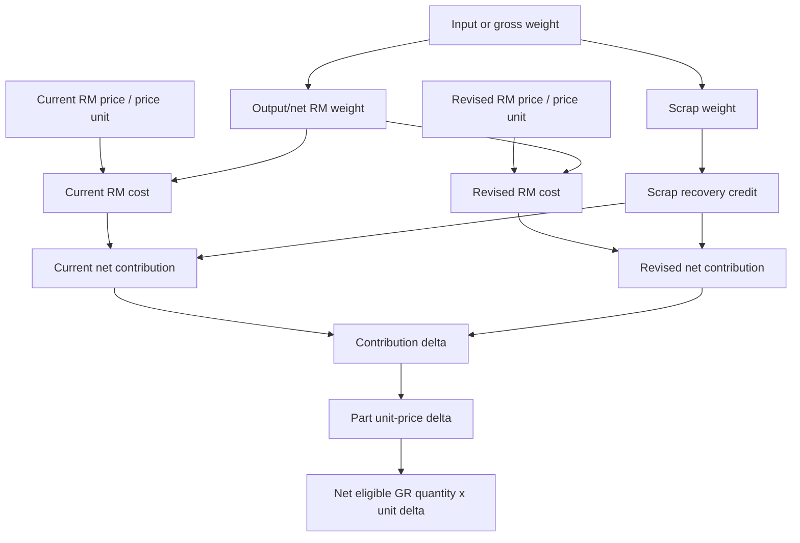

# Enriched Retrospective Pricing Workbench Design

## Purpose and source boundary

This design translates the business capabilities visible in pages 1-38 of `artefacts/SAP Vistex Retro Pricing Automation for TML PV.pdf` into the RMC application's canonical model. It does not reproduce proprietary implementation details or screens. `PROJECT_GUIDELINES.md` remains binding where the reference material and project controls differ.

Confirmed persona ownership, master-data rules, vendor-part-contract behavior, composition revisions and the blocked price-document release process are specified in `docs/PERSONAS_AND_FUNCTIONAL_SCOPE.md` and take precedence over earlier inferred workflow details.

The workbench improves on the reference flow by joining explainability, immutable calculation evidence, exception readiness, reconciliation, and clean-core adapter boundaries into one trial-safe experience.

## Product flow



## Capability mapping from pages 1-38

| PDF pages | Reference capability | RMC interpretation and improvement |
|---|---|---|
| 1-7 | Cover, agenda, solution positioning, generic SAP landscape, industries and customer logos | Context only; no RMC transaction fields, formulas or workflow requirements were identified |
| 8-12 | Buyer/Finance operating model, component costing, holistic master data | Seven-stage workbench with explicit source, validity, owner, approval, and data-quality state |
| 13-17 | RM master search/detail, units, attachments, workflow | Governed type/grade hierarchy with status, evidence references, organizational scope, versioning, and immutable approval history |
| 18-19 | Composition search and top-down cost BOM | Effective-dated supplier/part profile, BOM lineage, constituent source, input/output/scrap weight, yield, and completeness |
| 20-22 | Revised-price maintenance by pricing area | Vendor/grade prices, scrap recovery, operations, defaults, validity, currency, price unit, and overlap validation |
| 23 | Retro-price amendment header | Canonical price-change request header with commercial, organizational, workflow, audit, and exposure fields |
| 24-27 | Component cost sheet | Server-calculated current/revised RM cost, scrap credit, net contribution, delta, adjustment, revised part price, and trace |
| 28-30 | Revised-price views | One canonical change set with drill-down by vendor, RM, part, plant, contract, and cost element |
| 31-33 | Simulation and estimation | Hierarchical preview plus independently visible formula inputs: weights, rates, GR quantity, unit delta, percentage, and impact |
| 34 | Summary analytics | Exposure by supplier, part, plant, grade, period, and status, with comparison visualizations |
| 35 | Approval workflow | Version-safe stage timeline with role, actor, timestamps, comments, thresholds, and segregation of duties |
| 36-37 | Posting stages and purchase-price retroaction | Separate controlled paths for contract price update and retrospective financial outcome, each idempotent and reconciled |
| 38 | Multi-level BOM pricing | Future multi-level explosion view; sales retraction remains outside the initial procurement scope |

## Important field catalog

### Price document header

- Document type, request number, external/reference number, reason, source/evidence reference
- Supplier/business partner, company code, purchasing organization/group, plant
- Contract/item, material/part, price reason and increase/decrease direction
- Valid-from/to, observation-from/to, cutoff timestamp and date-basis policy
- Currency, price UoM, price unit, current price, proposed price and percentage change
- Back-to-back indicator, estimated impact, affected parts/grades/receipts
- Lifecycle status, approval status, release/posting readiness, version and optimistic concurrency token
- Created/changed/submitted/decided actor and timestamp, decision comment and correlation ID

### RM and composition master

- RM type/category, grade/subgrade, scrap/recovery code, classification and controlled synonyms
- Material, description, plant, base UoM, BOM usage/alternative/change number/key date
- Supplier/contract context, profile validity/version/status and completeness
- Component lineage/path, item type, source, input weight, output/net weight, scrap weight
- Content quantity/percentage, yield/recovery/scrap factors, conversion and override reason
- Evidence/attachment reference, owner, approval history and data-quality findings

### Vendor pricing and calculation defaults

- Supplier/Tier-2 scope, RM/grade, operation or cost element
- Current/revised rate, scrap rate, machine/operation rate and efficiency where applicable
- Currency, per/price unit, UoM, valid-from/to, source/index basis
- Observation window, lag, average, premium/discount, floor/cap, no-change threshold and rounding
- Applicability precedence, overlap/gap policy, organizational scope and approval version

### Cost-sheet line

- Supplier, part/material, component/RM grade and scrap code
- Input weight, output weight, scrap weight and base UoM
- Current/revised RM price and scrap price
- Current/revised RM cost, scrap credit and net contribution per part
- RM-rate delta, scrap-rate delta, base delta, adjustment percentage/value and total delta
- Current/revised PO or contract price, currency, price unit and validity
- Inclusion/exclusion, exception/reason, formula trace and input snapshot IDs

### Simulation, approval and execution

- Net eligible GR quantity, movement policy, GR count, reversal/return quantity and exclusions
- Unit delta, price-change percentage, gross impact, prior posted/settled amount and amount proposed now
- Simulation/run/version/status, cutoff/config/rule-set snapshot and exception count
- Workflow step/role/actor/delegate, decision/comment/time and before/after hash
- Posting path, precheck, idempotency key, request hash, document/reference, response and ambiguity state
- Contract-update state, S/4 workflow state, reread result and concurrent-change check
- Calculated/approved/pending/posted/failed/reversed totals and reconciliation difference

## Component cost formula



Baseline trial formulas:

```text
input weight            = content quantity x configured gross/scrap treatment
output weight           = normalized approved content per part
scrap weight            = max(input weight - output weight, 0)
RM cost                 = output weight x RM price / price unit
scrap credit            = scrap weight x scrap price / scrap price unit
net RM contribution     = RM cost - scrap credit
line delta              = revised net contribution - current net contribution
part unit delta         = sum(included line deltas + approved adjustments)
revised contract price  = current contract price + part unit delta
retrospective impact    = net eligible GR quantity x part unit delta
```

Scrap settlement, adjustment percentages, taxes, freight, FX, price-unit conversion, and rounding level remain configurable policy decisions and must be approved before they affect a financial result.

## Improved workbench layout

```text
+--------------------------------------------------------------------------------+
| Request / supplier / validity       Approval | Release | Exposure | Data quality|
+--------------------------------------------------------------------------------+
| Master -> Composition -> RM Price -> Cost Sheet -> Simulate -> Execute -> Insight|
+--------------------------------------------------------------------------------+
| Commercial & organizational header | Workflow timeline | Evidence / exceptions |
+--------------------------------------------------------------------------------+
| Component cost sheet: weights | current/revised rates | contribution | delta     |
+--------------------------------------------------------------------------------+
| Current vs proposed cost composition | Unit delta x eligible GR = total impact   |
+--------------------------------------------------------------------------------+
| Contract update path | Retrospective posting path | Reconciliation and audit     |
+--------------------------------------------------------------------------------+
```

## Improvements beyond the reference pages

1. One canonical price-change object links the request, cost sheet, calculation, approval, contract proposal, posting, and reconciliation evidence.
2. Every amount has a human-readable trace and immutable input snapshot rather than relying on the current master-data view.
3. Data quality is a first-class gate: missing mappings, conversions, price gaps, overlapping validity, stale BOMs, and reversal-reference problems become owned exceptions.
4. Simulation compares current/proposed composition before approval and distinguishes unit-price impact from retrospective quantity exposure.
5. Approval is version-safe and shows role, organizational scope, threshold, actor, comment, and segregation-of-duty result.
6. Contract price update and retrospective financial posting remain separate state machines and reconciliation paths.
7. Ambiguous remote outcomes stop blind retries and require status inquiry.
8. Analytics reconcile calculated, excluded, pending, approved, posted, failed, and reversed amounts rather than showing only top-line impact.
9. Multi-currency/UoM and multi-level BOM capability are explicit adapter/policy extensions, not hidden assumptions.
10. The UI uses progressive disclosure: executive metrics first, then part, RM, GR, formula, workflow, and technical evidence drill-down.

## Delivery boundary

The current implementation is a synthetic trial workbench. The first increment calculates the cost sheet from existing approved profiles, constituents, vendor prices, contract prices, movement rules, and GRs. Scrap price, operation cost, cost-bucket masters, multi-level BOM explosion, attachments, multi-step approval, exception resolution, real posting, and S/4 contract update remain controlled follow-on increments.
